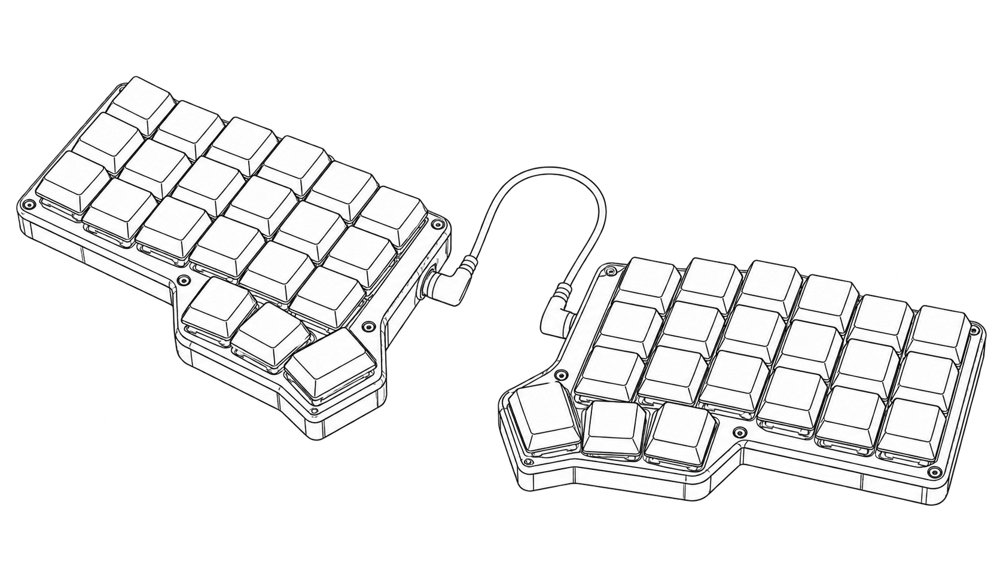

# Corne Keyboard V1



*Generated line-art concept illustration.*

A complete four-layer keymap and local layer guide for the original wired42-key Corne, using the official QMK `crkbd/rev1` target. One validated JSON source generates the actual C keymap, matrix-position guide, SVG cheat sheet, and browser data.

## Try the layout

Requires Python3.12+; no application packages are needed.

```sh
python3 tools/generate.py --check
python3 -m http.server 8799 --bind 127.0.0.1 --directory site
```

Open <http://127.0.0.1:8799>. Select a layer to inspect all42 positions. The guide does not capture keystrokes, access HID, send macros or flash a board. At narrow widths the keyboard diagram scrolls horizontally.

- BASE: QWERTY letters, dedicated modifiers, Space/Enter.
- NAV: numbers, arrows, editing, F1–F10.
- SYMBOL: punctuation and paired symbols.
- ADJUST: F11/F12, media keys and BOOT. Hold NAV and SYMBOL together to enter this layer on the real keyboard.

The left thumb MO(1) and right thumb MO(2) remain transparent through overlays so they can always be released. No tap-hold timing, passwords, dynamic macros, RGB or OLED behaviour is included. QMK's real tri-layer function owns active-layer behaviour; the browser is a label preview.

## Edit and check

```sh
# Edit keymap.json, then regenerate tracked artifacts:
python3 tools/generate.py
python3 -m unittest discover -s tests -v
python3 tools/test_native.py
```

The generator validates exact42-position layers and a limited keycode set before writing. Five tests check reference hashes, physical matrix uniqueness, code/bounds rejection, thumb fallthrough and exact output reproduction. The separate native C check compiles the actual generated tri-layer hook and tests256 state combinations under ASan/UBSan. It uses a small QMK API stand-in; it does not prove QMK USB or split operation. The real AVR build is a separate CI job.

[Full SVG guide](docs/generated/layers.svg) · [Matrix positions](docs/generated/layout.json) · [Contract](docs/contract.md) · [Assembly and physical checks](docs/assembly.md).

## Real firmware build

The workflow checks out official QMK at `180f394b489c238cb231c2bf8b080262155e03c0`, copies this project's keymap/rules/config, and runs `make crkbd/rev1:qeth` in the digest-pinned official QMK container. It uploads the resulting HEX as a workflow artifact. There is no privileged container, USB mount or flash command. See the current [checks](https://github.com/ungaaaabungaaa/corne-keyboard/actions) before using an artifact.

The full toolchain is kept off the development Mac. If you already have a QMK checkout and supported toolchain, put the three `firmware/` files in `keyboards/crkbd/keymaps/qeth/` and compile that target. Read the [official QMK compile guide](https://docs.qmk.fm/cli_commands) and [Docker guide](https://docs.qmk.fm/getting_started_docker) for the wider environment. Compilation is not flashing.

Target assumptions: ProMicro ATmega32U4, USB on the left half, original board wiring. Verify the actual controller, PCB and bootloader. RP2040, wireless and later integrated-controller boards require a different target/configuration. [Verification](docs/verification.md) records what ran. Physical assembly, soldering, key scanning, USB, both halves, debounce, firmware flash and ergonomic use remain pending.

## Attribution and repository history

Corne hardware is by foostan and contributors: [official source](https://github.com/foostan/crkbd). QMK firmware and the pinned board definitions are by QMK contributors; their GPL license is included. [UPSTREAM.json](references/UPSTREAM.json) pins reference bytes and the toolchain image. New source uses GPL-2.0-or-later for this integration. The board designs and generated concept artwork have their own provenance; no new hardware design ownership is claimed.

The original unrelated sample portfolio is preserved on `archive/before-corne-2026-10-27`; none of its code or images is reused. Repository identity and18stars are retained. This implementation was built on27October2026. [Cover provenance](docs/images/cover-provenance.json) identifies approved generated concept art, which is not evidence of an assembled keyboard.
